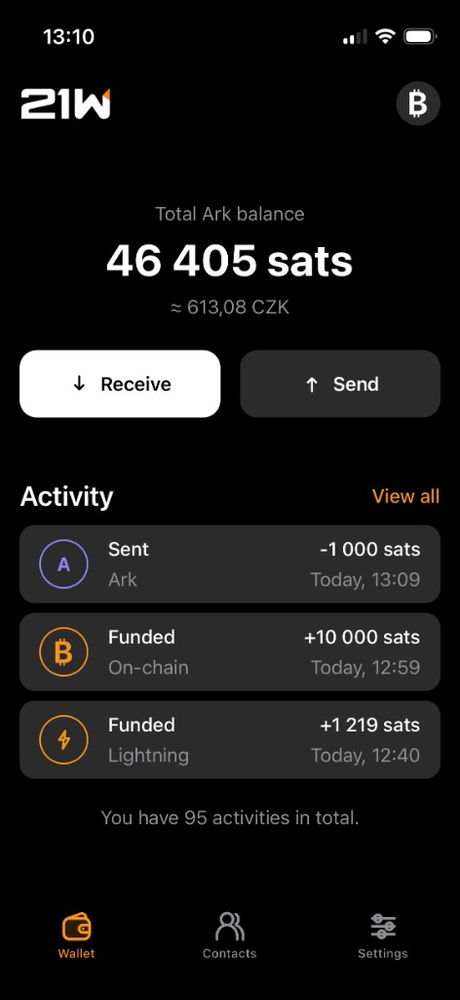
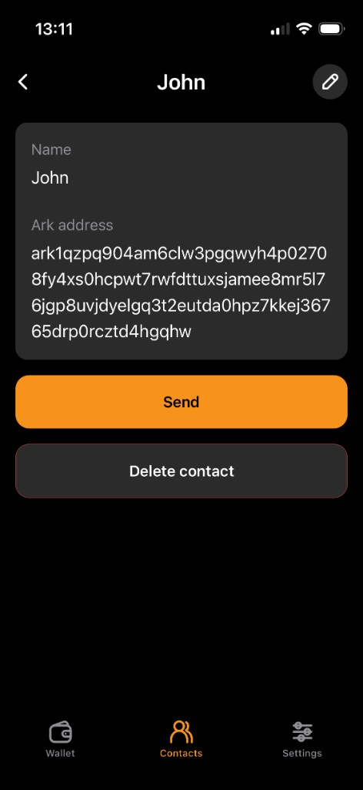
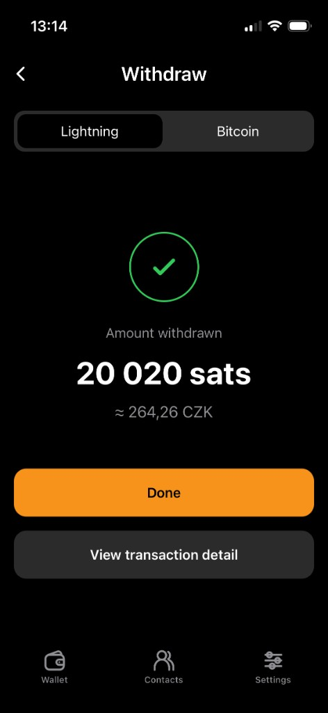
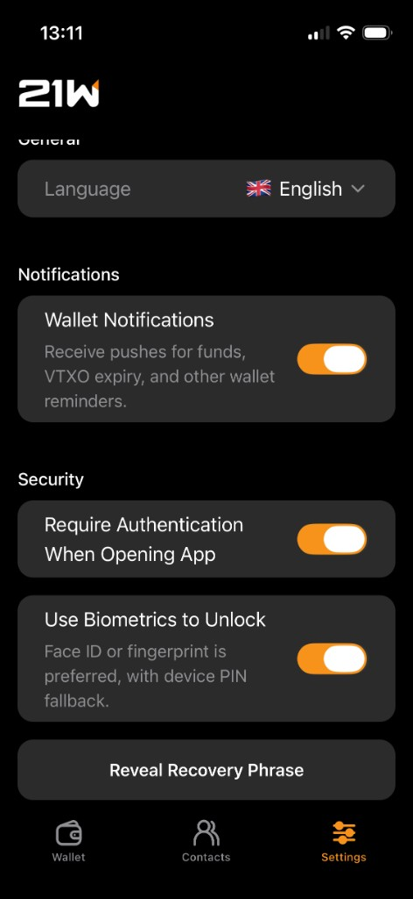

# 21W — Twenty One Wallet

Simple **self-custodial** Bitcoin mobile wallet powered by [Ark](https://arkadeos.com/).

This repository is published for **source transparency**: you can audit that the wallet is non-custodial and how it works. It is not a turnkey self-host kit — shipping your own builds still needs Apple/Google developer accounts, Expo/EAS, push credentials, and your own backend configuration.

**Product site:** [21w.app](https://21w.app) · **Support:** [support@21w.app](mailto:support@21w.app)

## What ships today

- Receive and send Bitcoin via **Ark**
- Fund / withdraw with **on-chain Bitcoin** (native Ark boarding / offboard)
- Activity history, local contacts / address book
- Optional **remote payment alerts** (push) via a non-custodial backend (no seed or funds on the server)
- iOS (TestFlight / App Store) and Android (sideload APK from the site)

## Repository layout

```
apps/mobile/    Expo React Native wallet
backend/        Non-custodial API (indexer watch + Expo push)
packages/       Shared typed API client
openapi/        OpenAPI contract
```

## Stack (overview)

| Area    | Choices                                              |
| ------- | ---------------------------------------------------- |
| Mobile  | TypeScript, Expo (SDK 54), Expo Router, React Native |
| Bitcoin | `@arkade-os/sdk` native ramps                        |
| Backend | Node.js, Express, Prisma, PostgreSQL                 |
| Push    | Expo Push (APNs / FCM via EAS)                       |

Mobile and backend local env templates: `apps/mobile/.env.example`, `backend/.env.example`. Real Firebase/`google-services.json`, EAS project IDs, and production API URLs are **not** committed.

## Screenshots

<p>
  
  
  
  
</p>

## License

[MIT](LICENSE)
